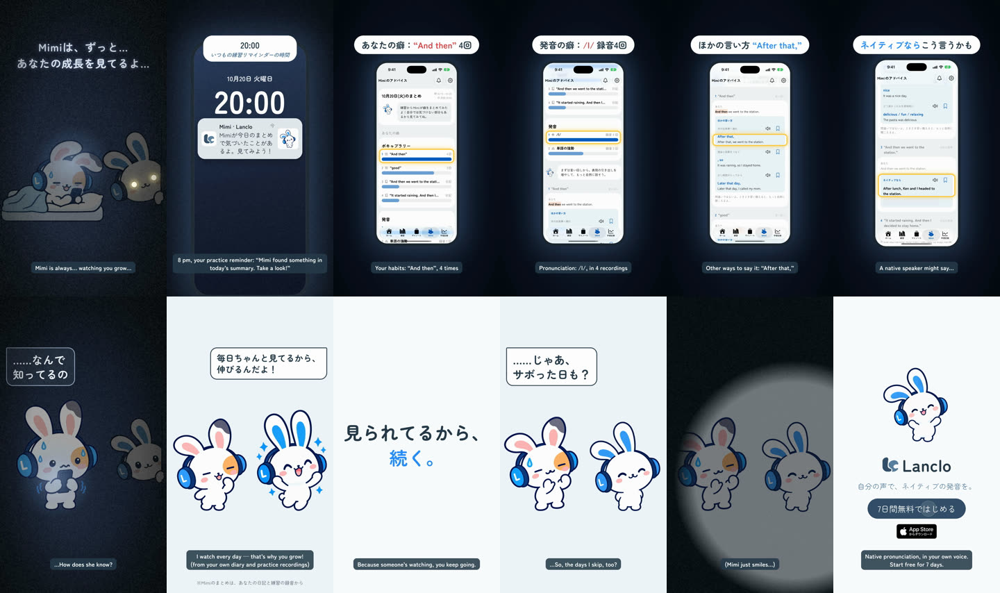

# Mimiはずっと見てる — 2D Mimiショート

[English](README.md) · **日本語**

ホラー風の冒頭：暗い部屋で友だちのスマホだけが光り、暗がりにMimiの目、ささやき「Mimiは、ずっと…あなたの成長を見てるよ…」。20:00に練習リマインダーが届く（気づきがある日のアプリの実際の文言「Mimiが今日のまとめで気づいたことがあるよ。見てみよう！」）。おそるおそる開くと、実アプリの「Mimiのアドバイス」：あなたの癖（“And then” 4回、/l/ 録音4回）→ほかの言い方「After that,」→ネイティブなら。「……なんで知ってるの」→ 明かりがつき、Mimiが説明「自分では気づかない癖、Mimiが見つけるよ！」→「いつも同じ表現・同じ単語ばっかり…」（“And then” 4回）→「ネイティブなら、こう言うよ！」としおりで保存（＋マイノート＝復習リスト）→ コピー「気づかない癖まで、Mimiが見つける。」→ また暗くなり、光る目でささやく「だから…僕のこと、ずーーーっと忘れないでね…」。暗い場面にはコードで作った静かなホラーBGM（音程の狂ったオルゴールの子守歌、心音、ふくらむ不協和な弦）。明かりのスイッチでぶつっと止まり、明るいテーマBGMに変わる。

0:22.0 / 1080×1920・60fps / 日本語の吹き出しと字幕（声なし）/ 公式2Dポーズ＋GSAP、実アプリ（シミュレーター）＋HyperFrames

2本：日本語のみ（`mimi-watching.mp4`）と英語字幕つき（`mimi-watching-en.mp4`）。完成版はLanclo Google Drive `002.SNS/024. Mimi Is Always Watching/`（`Watching_2026-10-21.mp4`、`Watching_EN-subs_2026-10-21.mp4`、録画は `Watching_assets/`）。

## ファイル

- [PROCESS.md](PROCESS.md)：オーナーの言葉と判断
- [PROMPT.md](PROMPT.md)：作り直すための統合プロンプト
- [prompts/](prompts/)：新しい3ポーズのCodexプロンプトとログ
- [source/](source/README.md)：アプリ映像、ポーズ、音、HyperFramesの編集、書き出し手順
- [CREDITS.md](CREDITS.md)：素材と権利
