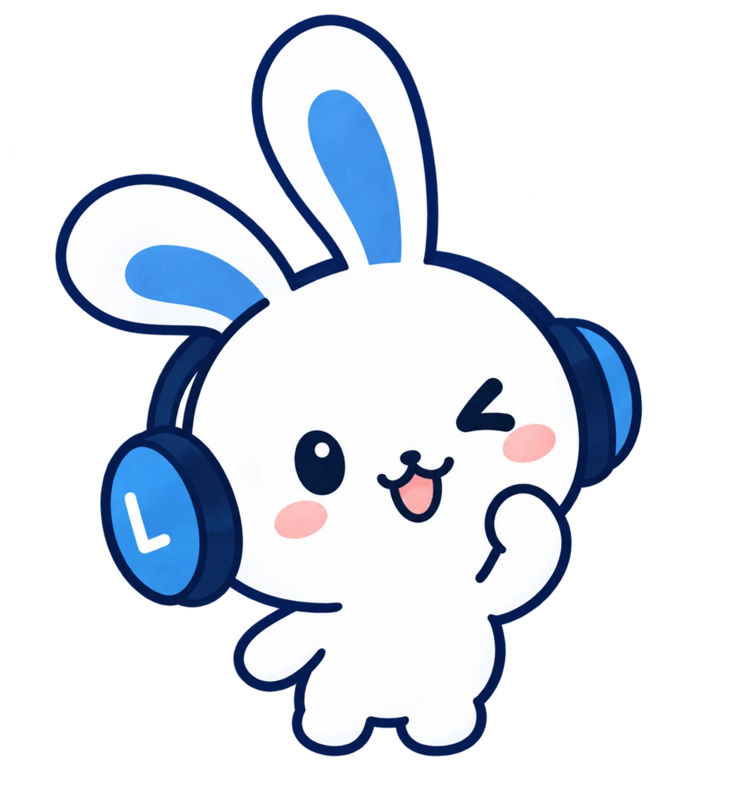
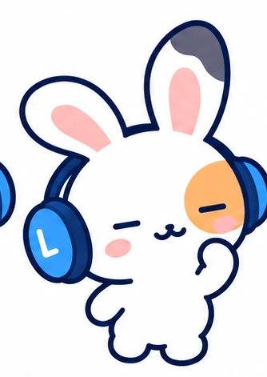
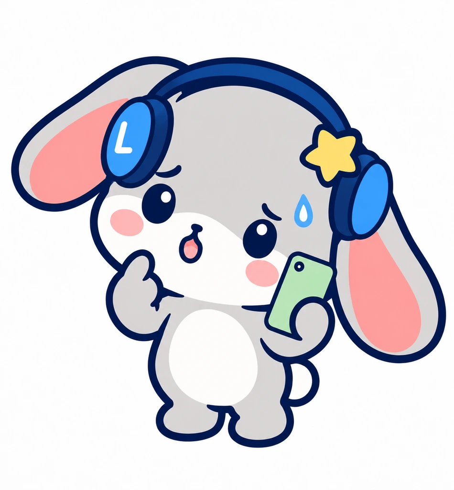
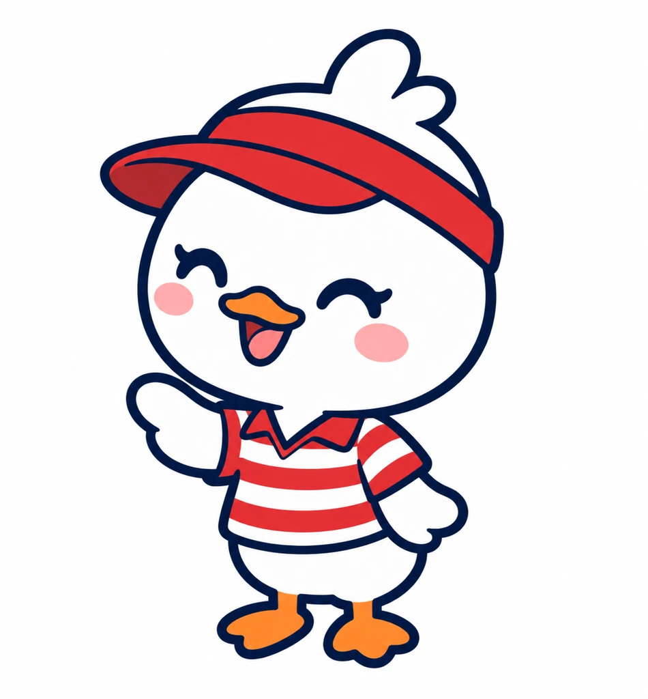

# Lanclo SNS cast (shared by every Mimi short)

The owner (2026-10-21): 「なんでちょこちょこ新しいキャラ出てるの？メインキャラは二人。ミミと友達。そこメインで回して。たまにAndroidのうさぎ。他店員とかでたまにでるのはいいけど統一感持たせたい」

So: **two main characters, Mimi and her Friend**, who carry every story. The **Android bunny** appears now and then. Any other role (staff, a foreigner / native speaker, a boss, a date) is played by the **small recurring side cast** below, never by a new character made for one episode. Everyone is drawn in the official Mimi 2D style: navy outlines of the same weight, flat soft colours, chibi proportions (big head, mitten hands, small feet), pink cheeks.

These images are copies of existing art (the reference for new poses), not redraws. When an episode needs a new pose, draw it with codex-p from these references (prompt template at the end), cut it out with `kits/mimi-short/scripts/cutout.sh`, and keep it in the episode until the owner approves.

## Main cast

| | Who | Look (must match exactly) | Source |
|---|---|---|---|
|  | **Mimi** (ミミ), the Lanclo mascot. The one who notices, explains and pops in. Japanese first person: 「僕」 | White bunny, **blue inner ears**, navy-and-blue headphones with a white **"L" on the cup at the viewer's LEFT**, pink cheeks, dot eyes | `mimi/master.webp`, `mimi/success.webp` (Lanclo official art, `kits/mimi-short/library/official/`) |
|  | **Friend** (友だち), Mimi's friend and the usual learner: the one who tries, slips, and gets better | White bunny like Mimi but with **sleepy flat line eyes**, **pink inner ears**, a **dark-grey tip on the ear at the viewer's RIGHT**, a soft **orange patch around the eye at the viewer's RIGHT**, the **same L headphones** (L on the viewer's LEFT cup) | `friend/sheet.webp` (the approved design, films/mimi-action-add `art/friend/chosen-2.png`), poses `friend/aww.webp` (mimi-action-add), `friend/yay.webp` (mimi-import), `friend/hello.webp` (mimi-multilang) |
|  | **Android bunny** (Androidのうさぎ), appears now and then (Android users, devices) | Light-grey **lop-eared** bunny (long floppy ears with pink insides), the same navy headphones with a white L and a small **yellow star** on the other cup, often holding a green phone | `android/ask.webp`, `cheer.webp`, `sulk.webp` (films/mimi-devices, branch `feat/mimi-devices`) |

The learner who mispronounces something is the Friend. Mimi reacts and teaches.

## Recurring side cast (only these)

| | Name | Roles | Look | Kokoro voice (English lines) | Source |
|---|---|---|---|---|---|
|  | **Bruno** (ブルーノ), bear | The foreigner / native speaker: hotel guest, host dad, foreign boss, tourist, colleague | Friendly brown bear, round ears, cream muzzle, small black nose, dot eyes, pink cheeks, about one head taller than Mimi; default outfit navy blazer + small red bow tie (role outfits allowed: apron, suit, Hawaiian shirt), no headphones | `am_michael` | `side/bear/` (films/mimi-disaster-sit, 037) |
|  | **Pippa** (ピッパ), duck | Staff: shop clerk, waiter, barista, receptionist | White duck, orange beak and feet, red-and-white striped uniform shirt, red visor cap with **no logo**, no headphones, one head taller than Mimi | `af_nicole` | `side/duck/` (films/mimi-disaster-coke, 041) |
|  | **Coco** (ココ), cat | The date / girlfriend, a classmate | Cream cat girl, triangle ears with pink insides, small whiskers, pink cheeks; big straw sun hat with a red ribbon (outfit changes by scene), no headphones, about the Friend's height | `af_bella` | `side/cat/` (films/mimi-disaster-beach, 038) |

Crowds or groups: repeat the side cast (Bruno with Coco, for example) rather than adding characters. Do not add a new recurring character without the owner's OK; propose it first.

## codex-p prompt template (new pose)

```
codex-p exec --skip-git-repo-check --sandbox workspace-write \
  --image kits/mimi-short/cast/mimi/master.webp,kits/mimi-short/cast/friend/sheet.webp,kits/mimi-short/cast/friend/aww.webp,<the side cast image> - < prompt.txt
```

```
Use your image generation tool. The attached images are the canonical Lanclo cast in the official 2D style:
master.webp = Mimi; sheet.webp and aww.webp = Mimi's Friend (white bunny, sleepy flat line eyes, pink inner ears,
dark-grey tip on the ear at the viewer's RIGHT, soft orange patch around the eye at the viewer's RIGHT, navy-and-blue
headphones with a white "L" on the cup at the viewer's LEFT) <and the side cast member: e.g. hello.webp = Bruno the bear>.
Match the character EXACTLY (shapes, markings, colours, headphones, proportions, outline weight). Plain pure white
background, full body, centred, same scale and head size as master.webp. No text, no letters, no logos except the white "L".
Save as PNG: art/<name>.png — <the pose, the expression, props, which way the character faces>.
```

Record the prompt in the episode's `prompts/` and the cast members used in its CREDITS.
